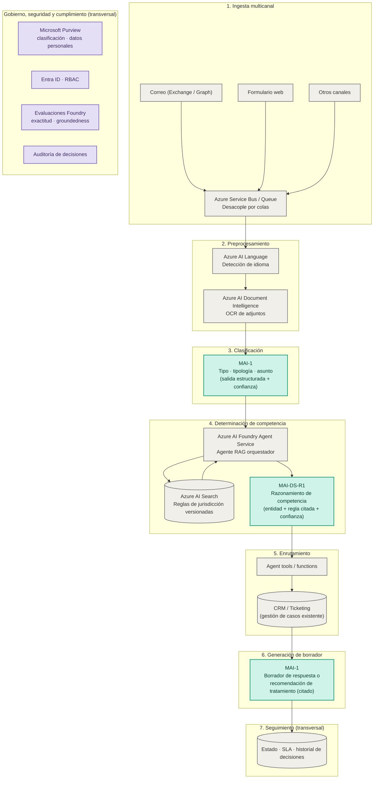
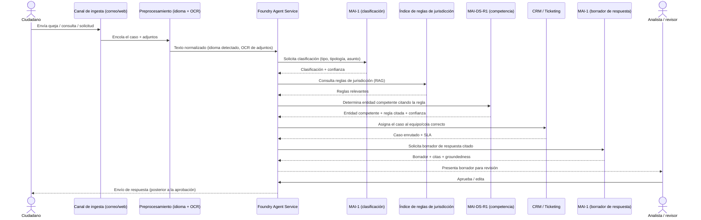

# AMV — Clasificación y Enrutamiento de PQR con Azure AI Foundry
### Arquitectura de referencia y diagrama lógico de la aplicación (caso full MAI)

> Basado en *"Caso 5 - AMV_Clasificacion_Enrutamiento_PQR_AI_Foundry.docx"* (v1.0, 16-sep-2026).
> A diferencia del documento original —que incluye una matriz de decisión MAI vs. modelos
> OpenAI—, este prototipo **no compara proveedores**: fija la **familia MAI** en todos los
> componentes de lenguaje del caso recomendado (**MAI-1** para clasificación y redacción,
> **MAI-DS-R1** para el razonamiento de competencia). Los servicios que no son modelos de
> lenguaje (OCR, búsqueda, colas, CRM, gobierno) se mantienen como infraestructura de Azure
> necesaria para que el flujo funcione, independientemente del modelo elegido.

---

## 1. Arquitectura de referencia en Azure

### Mapeo de servicio/modelo por componente (caso full MAI, sin comparación)

| Capa | Componente | Servicio / modelo | Notas |
|---|---|---|---|
| Ingesta | Correos, formularios, otros canales | Azure Service Bus / Queue | Infraestructura — desacopla el procesamiento por colas |
| Preprocesamiento | Detección de idioma | Azure AI Language | Infraestructura |
| Preprocesamiento | OCR de adjuntos | Azure AI Document Intelligence | Infraestructura |
| **Clasificación** | Tipo, tipología y asunto con salida estructurada | **MAI-1** | Fijado para este prototipo |
| Búsqueda | Índice de reglas de jurisdicción versionadas | Azure AI Search (+ embeddings de Foundry) | Infraestructura |
| **Competencia** | Determina entidad competente citando la regla | **MAI-DS-R1** (agente RAG) | Fijado para este prototipo — **mayor riesgo del flujo**, validar con conjunto dorado antes de producción |
| Enrutamiento | Asignación de caso a equipo/cola | Agent tools/functions + CRM/Ticketing | Infraestructura |
| **Generación de borrador** | Respuesta o recomendación de tratamiento citada | **MAI-1** | Fijado para este prototipo |
| Seguimiento | Estado, SLA, historial | Registro de casos (transversal) | Infraestructura |
| Gobierno | Seguridad, trazabilidad, cumplimiento | Microsoft Purview, Entra ID/RBAC, evaluaciones Foundry, auditoría | Transversal |

---

## 2. Diagrama lógico de la aplicación (flujo de una PQR)

Puntos clave del flujo lógico:

- **Human-in-the-loop no negociable**: MAI-1 y MAI-DS-R1 solo *proponen*; el analista aprueba
  la competencia y toda respuesta hacia el ciudadano.
- **Umbral de confianza**: casos por debajo del umbral se derivan automáticamente a revisión
  manual antes de enrutar o responder.
- **Reglas de jurisdicción versionadas y citadas**: cada asignación de competencia enlaza a
  la regla exacta que la fundamenta.
- **Auditoría integral**: se registra la decisión del modelo, la del revisor y el resultado final.

---

## 3. Por qué MAI en todo el caso recomendado (sin comparación)

El documento original propone una matriz MAI vs. OpenAI por componente. Para este prototipo,
siguiendo la instrucción de negocio, se **fija la familia MAI** en los tres componentes que
requieren un modelo de lenguaje:

- **MAI-1** para clasificación (tipo, tipología, asunto) — tarea de extracción estructurada
  de alto volumen, con salida validable por esquema.
- **MAI-DS-R1** para la determinación de competencia — es la decisión de **mayor riesgo**
  del flujo (define a qué entidad se traslada el caso), por lo que usa el modelo de
  razonamiento de la familia MAI apoyado en RAG sobre las reglas de jurisdicción.
- **MAI-1** para la redacción del borrador de respuesta — siempre citado y sujeto a revisión
  humana antes de enviarse al ciudadano.

Los servicios que no son modelos generativos (colas, OCR, búsqueda, CRM, gobierno) se
mantienen como infraestructura de Azure independiente del proveedor de modelo.

> Nota de gobernanza heredada del documento original: aunque aquí no se ejecuta un bake-off
> MAI vs. OpenAI, la determinación de competencia sigue siendo la decisión de mayor riesgo
> del flujo y debe validarse con un **conjunto dorado anotado por AMV**, midiendo exactitud
> de clasificación y *groundedness* sobre las reglas de jurisdicción, antes de pasar a producción.

---

## 4. Prototipo de demostración

Ver [index.html](index.html): mockup interactivo (datos simulados, sin backend) que
representa la **bandeja de triage de PQR** — búsqueda y filtros, detalle de clasificación
y competencia con regla citada, enrutamiento al equipo/cola correcto, y el panel de
**Borrador de respuesta con MAI-1** con citas, *groundedness* y revisión humana obligatoria.
Incluye una leyenda visual de qué modelo/servicio impulsa cada componente.

## 5. Próximos pasos (adaptados del documento original)

1. Consolidar la taxonomía de PQR y las reglas de competencia con las áreas jurídicas y de negocio.
2. Construir un conjunto dorado anotado por AMV (tipo, tipología, entidad competente).
3. Validar exactitud de clasificación y *groundedness* de MAI-1 / MAI-DS-R1 con evaluaciones de Foundry.
4. Extender esta PoC a un end-to-end con el CRM/ticketing real de AMV y canales productivos.
5. Definir el modelo de gobierno (Purview, RBAC, auditoría) y los umbrales de confianza con
   las áreas legal y de cumplimiento.

> La disponibilidad exacta, las capacidades (structured outputs, ventana de contexto), la
> región de despliegue y los precios de los modelos MAI en Foundry cambian con frecuencia y
> deben confirmarse en el catálogo del tenant de AMV antes de la decisión final.
