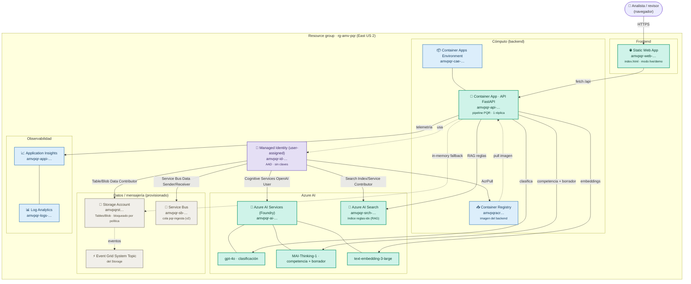

# Diagrama de Azure — artefactos desplegados (AMV · Clasificación y Enrutamiento de PQR)

> Grupo de recursos **`rg-amv-pqr`** · Región **East US 2** (AI Search en **East US**) ·
> Suscripción `bd70db0b-5ee5-488d-89c8-83cdd803614a`.
> Estado verificado el 2026-10-12 con `az resource list`.

## Arquitectura desplegada

**Leyenda de color**

| Color | Significado |
|---|---|
| 🟢 Verde | En uso activo en el flujo de la PQR (frontend, backend, modelos, búsqueda) |
| 🔵 Azul | Infraestructura de soporte (entorno ACA, registry, observabilidad) |
| 🟣 Morado | Identidad y seguridad (Managed Identity + RBAC, sin claves) |
| ⚪ Gris | Provisionado pero **no** en el camino activo (Storage bloqueado por política → el backend usa memoria; Service Bus y Event Grid quedan para v2) |

## Mapeo recurso → función

| Recurso Azure | Nombre | Rol en la app |
|---|---|---|
| Static Web App | `amvpqr-web-…` | Sirve `index.html` (modo live o `?demo=1`) |
| Container Apps Environment | `amvpqr-cae-…` | Entorno de ejecución del backend |
| Container App | `amvpqr-api-…` | API FastAPI: orquesta clasificar → competencia (RAG) → enrutar → borrador |
| Container Registry | `amvpqracr…` | Imagen del backend (build remoto, sin Docker local) |
| Managed Identity | `amvpqr-id-…` | Autenticación AAD a todos los servicios (sin claves) |
| Azure AI Services (Foundry) | `amvpqr-ai-…` | Despliegues `gpt-4o`, `MAI-Thinking-1`, `text-embedding-3-large` |
| Azure AI Search | `amvpqr-srch-…` | Índice `reglas-idx` para el RAG de competencia |
| Storage Account | `amvpqrst…` | Tables/Blob previstos; **bloqueado por política** (public access disabled) → backend en memoria |
| Event Grid System Topic | (del storage) | Eventos del Storage (creado automáticamente) |
| Service Bus | `amvpqr-sb-…` | Cola `pqr-ingesta` para ingesta desacoplada (v2) |
| Application Insights | `amvpqr-appi-…` | Telemetría/trazas del backend |
| Log Analytics | `amvpqr-logs-…` | Backend de logs (ACA + App Insights) |

> **Nota de gobernanza:** la política MCAP fuerza `publicNetworkAccess=Disabled` en el Storage,
> por lo que el Container App (sin VNet) no lo alcanza y el backend persiste en memoria. La
> persistencia duradera requeriría **VNet + Private Endpoint** (v2).
