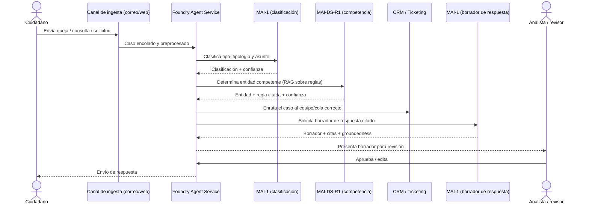

# AMV — Clasificación y Enrutamiento de PQR · Lógica y funcionamiento del prototipo

> Documento funcional del prototipo interactivo [index.html](index.html).
> Complementa a [ARQUITECTURA.md](ARQUITECTURA.md), que describe la arquitectura de
> referencia en Azure (caso full MAI, sin comparación con OpenAI). Aquí se explica
> **qué hace la app**, **cómo está construida** y **qué representa cada parte** frente
> a la solución real.

---

## 1. Propósito del prototipo

Es un **mockup interactivo de una sola página** (HTML + CSS + JavaScript, sin backend)
que simula la **bandeja de triage de PQR** de AMV: clasificación, determinación de
entidad competente, enrutamiento y borrador de respuesta. Todos los datos son
**ficticios** y viven en el navegador.

Lo que demuestra:

- Bandeja de PQR con búsqueda y filtros (tipo, canal, estado, banda de confianza).
- Detalle de un caso con **clasificación estructurada** (tipo, tipología, asunto) y su confianza.
- **Determinación de competencia** citando la regla de jurisdicción exacta que la fundamenta.
- **Enrutamiento** al equipo/cola correcto con estado y SLA.
- **Borrador de respuesta con MAI-1**, con citas, *groundedness* y revisión humana obligatoria.
- **Auditoría** (registro de decisiones) de cada acción del analista.
- La **arquitectura de referencia**, el diagrama lógico y el paso a paso del escenario.

---

## 2. Estructura de la interfaz

```
┌───────────────────────────────────────────────────────────────┐
│ Barra superior (marca AMV + etiqueta "Prototipo")             │
├───────────────────────────────────────────────────────────────┤
│ Leyenda de modelos (qué servicio impulsa cada componente)     │
├──────────────┬────────────────────────────────────────────────┤
│  Sidebar     │  Panel principal (pestañas):                   │
│  - Buscador  │   1. Bandeja de PQR                            │
│  - Filtros   │   2. Detalle y clasificación                   │
│  - Casos PQR │   3. Borrador de respuesta (MAI-1)             │
│              │   4. Gestionar datos (CRUD)                    │
│              │   5. Arquitectura (diagramas + paso a paso)    │
│              ├────────────────────────────────────────────────┤
│              │  Registro de auditoría / decisiones            │
└──────────────┴────────────────────────────────────────────────┘
```

### Pestañas

| Pestaña | Qué muestra | Servicio/modelo que representa |
|---|---|---|
| **Bandeja de PQR** | Casos que coinciden con la búsqueda y los filtros | Colas de ingesta + preprocesamiento |
| **Detalle y clasificación** | Texto del caso, clasificación con confianza, competencia con regla citada, enrutamiento (equipo/cola/SLA) | MAI-1 (clasificación) + MAI-DS-R1 (competencia, RAG) |
| **Borrador de respuesta (MAI-1)** | Borrador citado, *groundedness* y checklist de aprobación | Foundry Agent Service + MAI-1 |
| **Gestionar datos (CRUD)** | Alta/edición/borrado de casos PQR y reglas de jurisdicción (datos de la demo) | Solo prototipo (localStorage) |
| **Arquitectura** | Diagrama de referencia, flujo lógico, paso a paso y tabla de artefactos de Azure | Documentación embebida |

---

## 3. Modelo de datos (en memoria / localStorage)

El prototipo maneja dos colecciones guardadas en `localStorage` del navegador
(claves `amv_pqr_cases_v1` y `amv_pqr_rules_v1`). No hay servidor ni base de datos.

### Caso de PQR (`ticket`)
```js
{
  id: "PQR-2026-0143",
  canal: "Correo",                       // Correo · Formulario web · Otro
  fecha: "16/09/2026", hora: "09:12",
  remitente: "Inversionista persona natural",
  texto: "…texto de la queja/consulta/solicitud…",
  tipo: "Queja",                         // Queja · Consulta · Solicitud
  tipologia: "Conducta de intermediario",
  asunto: "Posible incumplimiento de deber de información",
  confClasificacion: 91,
  entidad: "AMV",                        // entidad competente
  reglaId: "REG-014",
  confCompetencia: 94,
  equipo: "Conducta de Mercado · Intermediarios",
  estado: "Enrutado",                    // Nuevo · Clasificado · Enrutado · Borrador generado · Pendiente revisión · Aprobado · Enviado · Cerrado
  slaHoras: 48,
}
```

### Regla de jurisdicción (`rule`)
```js
{ id: "REG-014", entidad: "AMV", texto: "…texto de la regla…", vigente: true }
```

> En la solución real, la clasificación y la competencia serían el resultado del pipeline
> de Azure (preprocesamiento → MAI-1 → RAG sobre el índice de reglas → MAI-DS-R1), no datos
> escritos a mano.

---

## 4. Flujo lógico de una PQR



Cómo se refleja cada paso en el prototipo:

1. **Bandeja** → función `runSearch()`: filtra los casos por texto, tipo, canal, estado y
   banda de confianza.
2. **Detalle** → `openTicket(id)`: pinta la clasificación, la competencia (regla citada) y
   el enrutamiento con `conf-pill` de color según la confianza.
3. **Borrador de respuesta** → `generateSynthesis()`: simula la orquestación (spinner +
   `setTimeout`) y produce un borrador con **citas** (`cite()`) que enlazan a la regla de
   jurisdicción, un valor de *groundedness* y un checkbox de aprobación.
4. **Aprobación humana** → `onReviewToggle()`: el borrador no se envía hasta que el analista
   lo marca como revisado.
5. **Auditoría** → `logAudit()`: cada acción (búsqueda, apertura, clasificación, generación,
   edición, aprobación) se registra con hora en el panel de auditoría.

---

## 5. Principios de diseño representados

- **Human-in-the-loop no negociable**: MAI-1 y MAI-DS-R1 solo *proponen*; el analista aprueba
  la competencia y toda respuesta hacia el ciudadano.
- **Umbrales de confianza**: los casos por debajo del umbral se marcan para revisión manual.
- **Decisión citada**: cada asignación de competencia enlaza a la regla de jurisdicción que
  la fundamenta ("Ver regla REG-xxx").
- **Auditoría integral**: trazabilidad de la decisión del modelo, la del revisor y el resultado.
- **Caso full MAI**: la leyenda y la pestaña de Arquitectura muestran que MAI-1 y MAI-DS-R1
  cubren la clasificación, la competencia y la redacción; el resto son servicios de
  infraestructura de Azure agnósticos al modelo.

---

## 6. Mapa de funciones (JavaScript)

| Área | Funciones clave |
|---|---|
| Persistencia | `loadData()`, `saveData()`, `resetDemoData()` |
| Inicialización | `init()`, `renderAll()` |
| Bandeja / búsqueda | `runSearch()`, `confBand()`, `highlightText()`, `renderResults()` |
| Detalle | `openTicket()` |
| Borrador de respuesta | `generateSynthesis()`, `cite()`, `toggleEdit()`, `exportReport()`, `onReviewToggle()` |
| Casos PQR (CRUD) | `renderTicketTable()`, `showTicketForm()`, `saveTicketForm()`, `deleteTicket()` |
| Reglas de jurisdicción (CRUD) | `renderRuleTable()`, `showRuleForm()`, `saveRuleForm()`, `deleteRule()` |
| Navegación | `switchTab()`, `renderArchDiagrams()` (Mermaid) |
| Auditoría | `logAudit()` |
| Seguridad | `escapeHtml()` en todo dato dinámico para evitar inyección de HTML/XSS |

---

## 7. Qué es simulado vs. qué sería real

| Elemento en la app | En el prototipo | En la solución real de Azure |
|---|---|---|
| Ingesta de canales | Casos precargados (seed) | Correo/Graph, formulario web, Service Bus/Queue |
| Idioma y OCR de adjuntos | No simulado (se asume texto normalizado) | Azure AI Language + Azure AI Document Intelligence |
| Clasificación | Valores escritos en el seed | MAI-1 con salida estructurada (JSON schema) |
| Reglas de jurisdicción y competencia | Lista editable en memoria | Azure AI Search (índice vectorial) + MAI-DS-R1 (RAG) |
| Enrutamiento | Campo `equipo`/`estado` en el seed | Agent tools/functions + CRM/Ticketing real |
| Borrador de respuesta | `setTimeout` + texto predefinido con citas | Foundry Agent Service invocando MAI-1 |
| Groundedness | Valor fijo (93%) | Evaluaciones de Foundry |
| Persistencia | `localStorage` del navegador | Almacenamiento gobernado + Purview + Entra ID |

---

## 8. Cómo ejecutarlo

Es un archivo estático; basta abrir [index.html](index.html) en un navegador moderno
(Edge/Chrome). Los diagramas de la pestaña **Arquitectura** se renderizan con Mermaid
cargado desde CDN, por lo que esa pestaña requiere conexión a internet la primera vez que
se abre. El resto de la app funciona **sin conexión**.

> Nota: los datos se guardan por navegador. El botón **"Restaurar datos de ejemplo"** de la
> pestaña *Gestionar datos* limpia `localStorage` y vuelve a los valores de fábrica.
